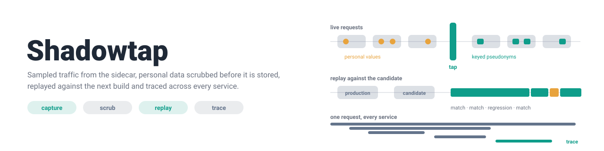
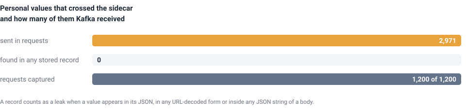
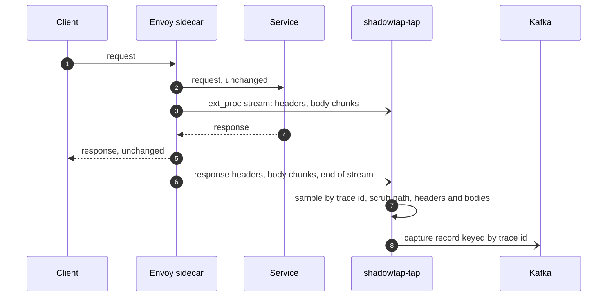
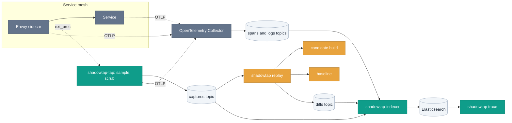
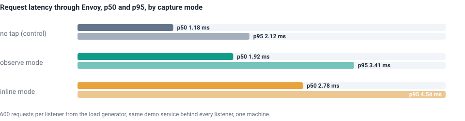
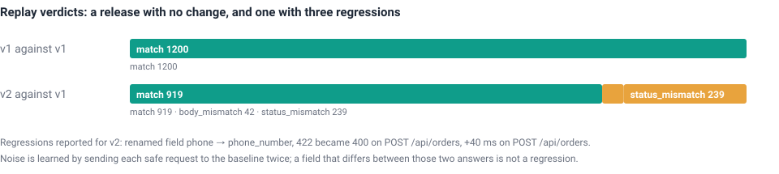
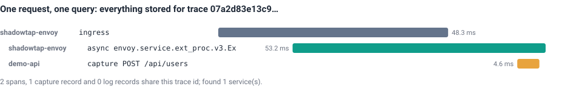

<picture>
  <source media="(prefers-color-scheme: dark)" srcset="docs/assets/banner-dark.svg">
  
</picture>

A sample of live traffic leaves the Istio sidecar, loses every personal value before it is stored, replays against the next build, and stays traceable across every service it touched.

       

[What reached Kafka](#what-reached-kafka) · [How it works](#how-it-works) · [Results](#results) · [Correctness](#correctness) · [Layout](#layout) · [Limits](#limits) · [References](#references) · [Getting started](docs/GETTING_STARTED.md)

## What reached Kafka

1,200 requests crossed the sidecar carrying 2,971 personal values: emails, cards, phones, social security numbers, addresses, tokens. Kafka received 1,200 records and 0 of those values.

<picture>
  <source media="(prefers-color-scheme: dark)" srcset="docs/assets/headline-dark.svg">
  
</picture>

| Measured | Value | Source |
|---|---|---|
| Requests through the sidecar, both capture modes | 1,200 captured of 1,200 | [`scripts/e2e-native.sh`](scripts/e2e-native.sh) |
| Personal values the load generator put on the wire | 2,971 distinct | [`examples/demo/traffic`](examples/demo/traffic) ledger |
| Those values found in any stored record, decoded every way | 0, and `shadowtap tail --check-pii` finds nothing | [`docs/results/capture.json`](docs/results/capture.json) |

## How it works

## Results

> [!NOTE]
> Every number below comes from one run of [`scripts/e2e-native.sh`](scripts/e2e-native.sh) on one laptop, with synthetic traffic; the files under [`docs/results`](docs/results) hold the raw aggregates and [`docs/assets/build.py`](docs/assets/build.py) draws the figures from them.

<picture>
  <source media="(prefers-color-scheme: dark)" srcset="docs/assets/overhead-dark.svg">
  
</picture>

| Path through Envoy | p50 | p95 |
|---|---|---|
| no tap | 1.18 ms | 2.12 ms |
| observe mode, Envoy never waits for the tap | 1.92 ms | 3.41 ms |
| inline mode, one reply per message | 2.78 ms | 4.54 ms |

Observe mode adds the cost of Envoy streaming each request to a second gRPC peer on the same CPU; the tap itself is never on the critical path.

<picture>
  <source media="(prefers-color-scheme: dark)" srcset="docs/assets/replay-dark.svg">
  
</picture>

| Replay of a 60 s window | Verdict | Gate |
|---|---|---|
| v1 against v1, 1,200 captures in 0.2 s | 1,200 match, 0 mismatch | passed |
| v2 against v1 | 919 match, 42 body, 239 status, p95 2.0 ms to 41.6 ms | failed, three regressions named |

The candidate differed from the baseline in 12,721 places that were identical between two baseline answers, so none of them counted; the 185 values that changed between two answers to the same request were learned as noise.

<picture>
  <source media="(prefers-color-scheme: dark)" srcset="docs/assets/trace-dark.svg">
  
</picture>

| `shadowtap trace` for one request | Found | Where it came from |
|---|---|---|
| sidecar spans | 2, the ingress and its ext_proc stream | Envoy's OpenTelemetry tracer, through the Collector and Kafka |
| capture record | 1, with its redaction counts | the tap, through Kafka |
| time from request to answer | 5 s | the indexer's batch interval plus Elasticsearch refresh |

## Correctness

| Configuration | Tests | Result |
|---|---|---|
| `go test -race ./...`, 28 packages, Go 1.26 on darwin/arm64 | 479 tests, 1,050 subtests | pass |
| `go test -fuzz`, 14 targets, 10 s each | 27.4 million executions, 14 inputs kept as regression seeds | pass |
| end to end without Docker: Envoy 1.39.1, in-memory broker, both capture modes, both replays | 12 checks | pass |
| end to end with Docker: Kafka 4.3.1 and Envoy v1.39 containers, linux/arm64 | 8 checks | pass |
| manifests: Envoy's own proto validation, every kustomization rendered, mesh policies cross-checked | part of `go test` | pass |

## Layout

| Directory | Purpose |
|---|---|
| [`cmd/shadowtap-tap`](cmd/shadowtap-tap) | the ext_proc server the sidecars stream to |
| [`cmd/shadowtap`](cmd/shadowtap) | `tail`, `replay` and `trace` for operators |
| [`cmd/shadowtap-indexer`](cmd/shadowtap-indexer) | Kafka to Elasticsearch |
| [`internal/tap`](internal/tap) | the ext_proc state machine, observe and inline modes |
| [`internal/scrub`](internal/scrub), [`internal/sampling`](internal/sampling) | detectors and keyed pseudonyms; trace-consistent sampling |
| [`internal/capture`](internal/capture), [`internal/kafka`](internal/kafka) | the record schema, the Kafka producer and consumers |
| [`internal/replay`](internal/replay), [`internal/diff`](internal/diff) | window source, scheduler, request builder, runner, diff engine, reports |
| [`internal/telemetry`](internal/telemetry), [`internal/index`](internal/index), [`internal/tracequery`](internal/tracequery) | OpenTelemetry setup, the indexer, the trace query |
| [`examples/demo`](examples/demo) | the demo API, its v2 regressions and the load generator |
| [`deploy`](deploy) | docker compose, Kubernetes, Istio, Collector, Kibana |
| [`test`](test), [`scripts`](scripts), [`docs`](docs) | integration tests, manifest checks, end-to-end runs, results and figures |

## Limits

| Limitation | Consequence |
|---|---|
| Observe mode needs Envoy 1.31 or Istio 1.23 | older meshes use inline mode, 1.6 ms more per request at p50 here |
| 128 KiB of each body is kept; binary, multipart and gRPC bodies are not | such requests replay without a body |
| Detectors know emails, cards, SSNs, phones, IPs, JWTs, API keys and named fields | a name in free text, an OAuth code or an IPv6 address in a path is not redacted |
| Pseudonyms are keyed per deployment | rotating the key breaks joins with older captures |
| Mutating requests replay only with `--allow-mutating`, noise is learned for safe methods only | candidates need disposable state and ignore rules for fields that change on writes |
| The tap and demo binaries do not read a telemetry block yet | their spans export only when a tracer provider is wired in; the replayer and indexer export today |
| The local stack runs one Elasticsearch node without authentication | a layout for laptops, not for a cluster |
| Overhead numbers come from one laptop | compare the rows with each other, not with production |

## References

| Reference | Used for |
|---|---|
| [Envoy external processing filter](https://www.envoyproxy.io/docs/envoy/latest/configuration/http/http_filters/ext_proc_filter) | the capture protocol: observability mode, `mode_override`, header `raw_value` |
| [W3C Trace Context](https://www.w3.org/TR/trace-context/), [B3](https://github.com/openzipkin/b3-propagation) | `traceparent` and the fallback headers, propagated through Kafka |
| [OpenTelemetry semantic conventions](https://opentelemetry.io/docs/specs/semconv/) | span attributes, log correlation, document fields |
| [Elastic Common Schema](https://www.elastic.co/guide/en/ecs/current/index.html) | field names in Elasticsearch |
| [Diffy](https://github.com/opendiffy/diffy) | suppressing noise by asking the baseline twice |
| [franz-go](https://github.com/twmb/franz-go) | the Kafka client, its idempotent producer and the in-memory broker used by the tests |
| [RFC 6666](https://www.rfc-editor.org/rfc/rfc6666), [RFC 5737](https://www.rfc-editor.org/rfc/rfc5737), [Luhn](https://en.wikipedia.org/wiki/Luhn_algorithm) | reserved address ranges for pseudonyms and demo traffic; Luhn-valid card pseudonyms |
| [RFC 9659](https://www.rfc-editor.org/rfc/rfc9659) | the zstd window limit when decoding compressed bodies |
